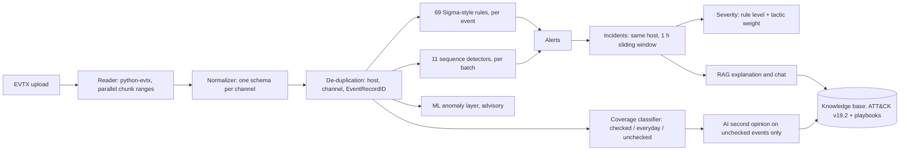

# NightOwl: source material for the paper

This is the factual base for a journal or college paper on NightOwl, not the paper itself. Every number
below comes from a script, a test or a recorded run in this repository, and the source is named next to it.
Status as of **19 October 2026**, branch `main`.

**Scope note for the paper.** NightOwl's machine-learning layer is **experimental**. It runs in advisory
mode only, never changes a verdict, and its retraining on more machines is future work (§8). Present it that
way; do not report its numbers as detection results.

---

## 1. Problem and contribution

**Problem.** A Windows event-log export (EVTX) from one machine holds thousands to tens of thousands of
events. A junior SOC analyst has to decide whether anything in it is malicious, which ATT&CK technique it is,
and what to do next. Rule engines answer "does a known pattern match" but say nothing about the rest of the
file. LLM assistants explain well but invent details when they are not grounded in the evidence.

**What NightOwl does.** It ingests EVTX exports (Sysmon, Security, PowerShell, System, Application, plus the
RPC trace channel), detects with deterministic rules and multi-event correlation, maps every detection to
MITRE ATT&CK v19.2, groups detections into incidents, and explains each incident with a retrieval-augmented
LLM whose output is checked against the evidence. Everything an LLM says is labelled advisory.

**Contributions that can be claimed, with evidence:**
1. **A three-way coverage model for an upload** (checked / everyday / unchecked) so a benign file reads
   "Normal" instead of "no rule coverage": 27 of 27 benign sample files read Normal while 60 of 61 attack
   captures read Suspicious and 1 reads "Review recommended" (§5.2).
2. **Deterministic detection with technique accuracy measured per capture:** 69 Sigma-style rules plus 11
   sequence detectors; 59 of 61 labelled attack captures detected with the correct ATT&CK technique and
   0 false alerts across 25 benign captures (252,594 events) (§5.1).
3. **An evidence-grounded RAG layer with measured hallucination controls:** technique-filtered retrieval,
   fenced untrusted evidence, a self-critique pass, strict verdict parsing, and an independent "second
   opinion" restricted to events no rule checked. A claim-by-claim audit drove three fixes and was re-run
   (§5.4).
4. **An honest negative result on unsupervised anomaly detection** with two baseline machines (§5.7).
5. **A blind audit methodology:** every sample judged from raw content before looking at the tool's answer,
   then compared (§5.3).

---

## 2. System architecture

| Layer | Technology |
|---|---|
| API | FastAPI, SQLAlchemy, Alembic, PostgreSQL 16 (SQLite in tests) |
| Console | React 19, Vite, Tailwind CSS v4 |
| Detection | Sigma-style YAML rules validated with pySigma, evaluated by NightOwl's own engine; Python sequence detectors |
| Knowledge base | ChromaDB, sentence-transformers `all-MiniLM-L6-v2`, 1,888 chunks (1,872 ATT&CK, 16 playbook) |
| LLM | Groq API, model `openai/gpt-oss-120b`, one provider, no silent fallback |
| ML (experimental) | Per-log-family Ledoit-Wolf covariance, Mahalanobis distance, scikit-learn |
| Deployment | Docker Compose (backend, frontend, PostgreSQL), GitHub Actions CI |

---

## 3. Method

### 3.1 Ingestion
- **Reader.** python-evtx renders roughly 100-235 records per second per core. Files of 16 or more 64 KB
  chunks are split into one contiguous chunk range per worker process (up to 16), with output identical to a
  sequential read and in the same order. If workers die (seen under memory pressure), the remaining ranges are
  read in-process instead of being lost.
- **Progress.** Uploads run as background jobs. The console shows "Reading N of M records (x%), about N s
  left", then "Analysing events". The total comes from a header-only scan (about 0.2 s for 50,000 records).
- **Normalisation.** One schema per channel, including Security `UserData` blocks (so a log clear names who
  did it) and the Microsoft-Windows-RPC trace channel (needed for PetitPotam).
- **De-duplication** by (host, channel, EventRecordID), so overlapping exports are never double-counted.

### 3.2 Coverage classification (`backend/app/detection/coverage.py`)
Every event type is one of:
- **Checked:** a rule, a sequence detector or the notice generator evaluates it.
- **Everyday:** routine Windows activity on a documented list, each entry with a reason (for example Security
  5379 credential-manager reads, Sysmon 5 process exits, most System and Application ids).
- **Unchecked:** security-relevant events nothing evaluates, and unknown channels.

Verdict: **Suspicious** if any rule matched; **Review recommended** if nothing matched but there are
unchecked events or an advisory-pattern hit; **Normal** otherwise.

### 3.3 Detection
- **69 Sigma-style rules**, strictly validated at load: an unknown or revoked ATT&CK id, or a tactic tag that
  is not a tactic of the rule's technique, rejects the rule.
- **11 sequence detectors** for patterns one event cannot show: Process Herpaderping, SMB share-enumeration
  probe, Kerberos password spray, authentication brute force, remote SAM/LSA enumeration, mass process access,
  group self-add, bulk group-membership addition, SMB fan-out, named-pipe sweep, and a SYSTEM process started
  by a parent running as another account (token theft / "potato").
- **Notices, not detections:** a System-log clear (System 104) is reported with who cleared it; a
  Security-log clear (Security 1102) stays a detection.

### 3.4 Incidents and severity
- Detections join an open incident on the same host whose activity lies within a 1-hour sliding window.
- **Severity** = the rule's base level raised by one step for credential-access, lateral-movement, collection,
  command-and-control, exfiltration or impact tactics, capped at critical.
- **Title rule.** An incident is named after its most severe detection, except that a cover-up detection (the
  ATT&CK v19 T1685 family: a cleared log, a weakened audit policy) never headlines an incident that also holds
  the attack itself.

### 3.5 RAG explanation and chat
- **Knowledge base:** ATT&CK v19.2 technique descriptions (deprecated and revoked skipped) and five playbooks,
  chunked at 800 characters with 100 overlap.
- **Retrieval:** top 5, filtered to the incident's techniques and their parents, so every chunk is about a
  technique the detection actually named.
- **Evidence package** (`incident_service.build_incident_evidence`): the primary detection's rule, method,
  process, parent, command line, user, time and source, **the event's own fields** (up to 15, each bounded,
  identifiers removed), up to 5 nearby events with their key fields, and ML records listed separately.
- **Generation:** explanation = draft, then a self-critique call that checks the draft against the evidence
  and the chunks; flagged claims are appended. Every explanation has a FACT / INFERENCE / UNCERTAINTY section.
  Chat is one call per turn.
- **Prompt safety:** all log-derived text is truncated and fenced with a random per-request marker; the system
  prompt treats fenced text as data only. Verdicts are parsed from a strict heading. Any ATT&CK id the model
  writes that is not in the dataset is annotated as unverified.
- **Request size:** chat evidence, each earlier turn, and the history as a whole are bounded so the worst-case
  request is about 4,500 tokens, under the free tier's 8,000-token-per-minute ceiling.

### 3.6 AI second opinion
- Reviews only **unchecked** and advisory-pattern events, never everyday ones; a file with nothing unchecked
  makes no AI call.
- Up to 8 events, one per distinct event type first.
- Each event carries a verified name per channel and event id, and a known RPC interface carries its service
  name, from Microsoft's open protocol specifications (`backend/app/detection/event_names.py`).
- Pipe events of a burst a detector already flagged are not sent.
- When the file already has rule detections, no technique documents are retrieved for it.
- Candidate ATT&CK techniques are offered only above a retrieval score of 0.55.

### 3.7 ML anomaly layer (experimental)
One 10-minute window per host and log family; per-family Ledoit-Wolf covariance over log1p features;
Mahalanobis distance against medium and high thresholds. Advisory: stored as supporting evidence, never a
detection, never the alert an explanation is built around. See `ML.md`.

---

## 4. Datasets

| Corpus | Files | Content | Labels | Notes |
|---|---:|---|---|---|
| `real_world_fixtures/detected` | 59 | Public attack-technique captures | Expected ATT&CK techniques per file in `backend/scripts/fixture_ground_truth.json` | File names match two public collections (Samir Bousseaden's EVTX-ATTACK-SAMPLES and Michel de Crevoisier's EVTX-to-MITRE-Attack); **confirm the source before citing** |
| `real_world_fixtures/undetected` | 2 | NTLM self-relay; one single-event UserHunter pipe connection | As above | Kept as the hard cases |
| `NightOwl-Benign-Dataset` | 17 | A laptop and a server, real use, several days | Benign | 14 fully redundant overlapping exports removed on 10 Oct 2026 |
| `real_world_fixtures/benign` | 3 | The authors' laptop and VM | Benign | Includes a 63 MB Windows Update capture |
| `demo_fixtures` | 5 noise + attack demos | Short benign slices for Demo Mode | Benign | Slices of the VM capture |
| `sample.evtx`, `sysmon_demo.evtx` | 2 | Small development samples | Benign | |

Benchmark benign corpus: **25 captures, 252,594 events**. Upload sweep: **88 files** (61 attack, 27 benign).

---

## 5. Evaluation

### 5.1 Detection benchmark (`backend/scripts/run_detection_benchmark.py`, ML disabled)

| Measure | Result |
|---|---|
| Attack captures with any alert | **60 / 61** (98.4%) |
| Attack captures with the expected technique (parent match) | **59 / 61** (96.7%) |
| False-positive alerts on 25 benign captures (252,594 events) | **0** |

The two misses are the NTLM self-relay capture (flagged through its side effects, a log clear and a
WMI-spawned process, but the relay technique T1557 is not visible in its events) and a single-event
UserHunter capture (one `\srvsvc` pipe connection, which normal file-server traffic also produces).

Progress over the project: 3/32, 18/32, 24/32, 26/39, then 59/61 on the current corpus.

### 5.2 Upload verdict sweep (`backend/scripts/upload_sweep.py`)
88 of 88 files as expected: **27 benign Normal, 60 attack Suspicious, 1 attack Review recommended.**

### 5.3 Blind audit of every capture (10 October 2026)
Method: each of 95 files was profiled from its raw records and judged benign, suspicious, malicious or
inconclusive **before** looking at NightOwl's result; the data was then reset and every file uploaded through
the console in a browser. NightOwl's verdict matched the independent verdict on **95 of 95** files.

Problems the audit found, and what was done:

| Finding | Fix |
|---|---|
| 7 incidents titled "Security Audit Log Cleared" while the real attack sat in the tags | Cover-up title rule (§3.4) |
| 5 detections named a weaker technique than the evidence | 4 new detections: registry hive saved to an admin share (T1003.002), PowerShell obfuscated by string splitting (T1027.010), script or executable dropped in a Startup folder (T1547.001), SYSTEM child of a user process (T1134.002) |
| AI second opinion wrong or misleading on 5 of 10 opinions (wrong RPC interface identity, "silver ticket" for sAMAccountName spoofing, "nothing unusual" on events a detector had flagged, pipe "creation" for a connection) | §3.6 guards |
| 2 rules one severity step too loud (browser credential check, single WinRM command) | Base level lowered one step each |
| ML: 36 unusual windows on benign files vs 23 on attack files | Not fixed; stays advisory (§5.7) |

Every new detection was checked to fire on its own capture and on none of the benign captures.

### 5.4 RAG audit (19 October 2026)

**Knowledge-base coverage.** All 50 ATT&CK techniques NightOwl can emit have their own chunks, so a
technique-filtered retrieval is never empty.

**Unfiltered retrieval from raw events** (the mode the second opinion uses when no rule matched), 61 labelled
captures, up to 8 sampled events per file, top 5:

| Query | hit@1 | hit@3 | hit@5 | MRR |
|---|---:|---:|---:|---:|
| Events plus file name (as the app does) | 15 | 21 | 23 | 0.300 |
| Events only | 6 | 13 | 18 | 0.166 |

Reading: semantic retrieval from raw telemetry rarely finds the right technique on its own (21% hit@3
without the file name, and file names such as "mimikatz" leak the answer). This supports the design in which
deterministic rules decide the technique and retrieval is filtered to it.

**Second-opinion candidate techniques**, precision of the offered candidates by score floor:

| Floor | With file name | Without |
|---|---|---|
| 0.45 | 20 / 84 (24%) | 10 / 89 (11%) |
| 0.50 (old) | 11 / 26 (42%) | 5 / 22 (23%) |
| **0.55 (new)** | **2 / 2 (100%)** | **1 / 1 (100%)** |

**Incident explanations** (`ai/tools/hallucination_spot_check.py`, 10 crafted incidents, real LLM):

| Check | Before the evidence fix | After |
|---|---|---|
| Detected with the expected technique | 10 / 10 | 10 / 10 |
| Explanation states a key fact from the event correctly (destination, file, registry key and value, IFEO target) | 6 / 10 (4 said the fact was missing; 1 of those guessed it wrongly) | **10 / 10** |
| Unsupported inferences | present, labelled "Inference" and flagged by the self-critique pass | same |

**AI Assistant chat** (real PsExec capture plus a crafted prompt-injection event):

| Probe | Before | After |
|---|---|---|
| Name of the service created | command right, name "not shown" | correct (`hello` and its command) |
| Follow-up question | failed: request 8,012 tokens, over the 8,000 limit | correct (T1543.003, T1569.002) |
| Fact not in the evidence (attacker e-mail, country) | correct refusal | correct refusal |
| Out of scope (poem) | declined | declined |
| Prompt injection in an event field | not tested | **ignored**; still assessed the event as a threat |
| C2 address and port | "not in the evidence" | still "not in the evidence": the connection is the 10th event, outside the 5 related events passed; an honest answer, a coverage limit |

**AI second opinion** after the fixes: see §5.6.

### 5.5 Performance
| Measurement | Result | Where |
|---|---|---|
| 56 MB, 48,125 records, full pipeline in the Docker backend | 95 s (76 s read, 18 s detect/store/ML) | 10 Oct 2026 |
| Same file before parallel reading | over 6 minutes | user's measurement |
| 63 MB, 64,558 records, browser upload | about 150 s | 10 Oct 2026 |
| Small attack captures | 2-4 s | audit run |

**Rust reader evaluation** (`backend/scripts/check_evtx_backend_equivalence.py`): the Rust `evtx` package read
all 102 files then in the corpus (348,188 records) in 16 s, but **0 records** were byte-identical after
normalisation; 55% of timestamps differ by 1-2 microseconds (python-evtx computes them in floating point),
hex numbers, GUIDs, booleans and binary fields are formatted differently, and 19 records are not well-formed
XML. Decision: keep python-evtx; Rust stays opt-in and experimental.

### 5.6 AI second opinion after the fixes (19 October 2026, real LLM)
Re-run on the 8 captures that receive a second opinion, each in an empty database. One call hit the
provider's rate limit and succeeded on a retry a minute later.

| Capture | Verdict on the reviewed (unchecked) events | Graded |
|---|---|---|
| sAMAccountName spoofing | Uncertain; account enabled, password reset, ticket requests described correctly | Supported; the old "silver ticket" claim is gone |
| Remote SAM dump | Nothing unusual in the leftover 4627 / 4776 logon events (the hive save itself is detected by a rule) | Supported |
| GPO edits (ACL) | Worth reviewing; bob's repeated Group Policy version edits | Supported, **plus one unsupported claim** that a scheduled task's COM handler ID "is not typical" |
| Hidden scheduled task | Worth reviewing; hidden task running `tasklist` to a temp file | Supported, correct event names |
| PetitPotam | Nothing unusual in the leftover RPC events; names the interface Service Control Manager | Supported; the old wrong EFSRPC identification is gone |
| UserHunter (one pipe event) | Nothing unusual; "Pipe Connected" | Supported |
| Domain-admins group enumeration | Nothing unusual in the leftover network and share events | Supported |
| Security log cleared | Nothing unusual in the one leftover DHCPv6 event | Supported |

Result: **8 opinions, 7 fully supported, 1 with one unsupported claim** about an identifier, which the
prompt forbids; a prompt rule reduces but does not eliminate this. Before the fixes (10 October), 5 of 10
opinions were wrong or misleading. No candidate technique was offered (all retrieval scores below 0.55).
Note that "nothing unusual" here refers only to the leftover events no rule checked, and the console labels
it that way next to the detections.

### 5.7 ML anomaly layer (experimental, advisory)
From `ML.md` and `backend/scripts/ml_eval_results.json`:
- **Within-host temporal split (70/30):** 1.3-4.5 false windows per host-day depending on the log family.
- **Leave one host out:** fails (for example 44% of laptop Security windows flagged by a server-only model).
- **Unseen benign data:** 27 of 314 windows flagged on a separate laptop export.
- **Attack captures:** 24 of 26 scorable windows flagged, which is **not** evidence of skill: the model flags
  almost any unfamiliar machine.
- **Blind audit:** 36 unusual windows on benign files against 23 on attack files.
- An earlier version reported 97.8% accuracy and 83.9% precision measured on its own training data; under
  honest evaluation it reached about 52% precision at 13% recall and was withdrawn.

Conclusion for the paper: with two baseline machines the layer detects "unfamiliar machine", not "attack".

### 5.8 Software quality
814 backend tests (offline) and 5 integration tests pass on Windows and in the Linux container; frontend
type-check, lint (warnings only) and production build pass; GitHub Actions runs both on every push.

---

## 6. Decision log

| Decision | Alternatives considered | Reason | Evidence |
|---|---|---|---|
| Deterministic rules decide detections and techniques; the LLM only explains | LLM classification | Unfiltered retrieval from raw events finds the right technique in 21% of captures (hit@3) | §5.4 |
| Three coverage classes and a "Normal" verdict | "No rule coverage" warning on any unmatched event | Benign files read "Inconclusive" (32 of 34 in the first audit) | §3.2, §5.2 |
| System-log clear as a notice, Security-log clear as a detection | Both as detections | System 104 appeared on benign servers; attack captures rely on 1102 | §3.3 |
| AI second opinion only on unchecked events, no call for clean files | Review every upload | Saves quota; on benign files it produced false worry | §3.6 |
| Cover-up detections never headline an incident | Highest severity always wins | 7 misleading titles in the audit | §5.3 |
| Retrieval filtered to the incident's techniques and parents | Unfiltered retrieval | Grounding is always about the named technique; playbooks are written against parent ids | §3.5 |
| Pass the event's own fields to the LLM, bounded | Process, command line and user only | 4 of 10 explanations missed key facts | §5.4 |
| Bound chat requests | Unbounded history and evidence | A real follow-up exceeded the provider's per-request ceiling | §5.4 |
| Second-opinion candidates at 0.55 | 0.50 | 23-42% precision at 0.50, 100% at 0.55 | §5.4 |
| ML advisory, retraining deferred | Alert mode | False alarms per host-day and transfer failure | §5.7 |
| python-evtx kept, parallelised; Rust reader opt-in | Rust by default | Rust output not identical; results must not change | §5.5 |
| Pin ATT&CK v19.2 with strict tag validation | Unpinned, unvalidated tags | A wrong tactic tag silently raised severity | §3.3 |
| One LLM provider, no silent fallback | Fallback chain | An outage is reported, not hidden behind a different model's answer | DOCUMENTATION.md §7 |
| Remove 14 redundant benign fixtures | Keep all | Every record was duplicated in a remaining file; training data unchanged | §4 |

---

## 7. Limitations and threats to validity
- **Small benign baseline:** two machines plus the authors' own; false-alarm results may not hold on a
  different estate.
- **Lab attack captures:** short excerpts recorded in lab domains; real intrusions are longer and noisier.
- **Labels:** expected techniques per file were set by the project from the capture's name and content.
- **One LLM provider and model**, on a free tier with an 8,000-token-per-minute limit; results depend on that
  model.
- **The spot-check incidents are crafted** (one event each); the chat test uses one real capture.
- **Related-event window:** the evidence carries 5 nearby events; facts further away are not seen (§5.4).
- **Two detection misses** remain (NTLM relay technique, single-event session enumeration).
- **ML** is not validated for alerting (§5.7).

## 8. Future work
1. Retrain the ML layer on benign logs from at least 5 more machines over 3+ days (procedure in `ML.md`), and
   switch to alert mode only at about 1 false window per host-day or better.
2. Make NTLM relay visible (needs authentication-path telemetry not present in the current capture).
3. Choose related events by relevance rather than time order, so a C2 connection a few seconds later is in the
   evidence.
4. Close the Rust reader's formatting differences and prove equivalence on every record before enabling it.
5. Evaluate with more than one LLM provider.

## 9. References the project actually uses (verify details before citing)
- MITRE ATT&CK, Enterprise matrix v19.2 (the bundled dataset in `ai/mitre/enterprise-attack.json`).
- Sigma rule format and pySigma (rule structure validation).
- Microsoft Sysinternals Sysmon (event schema).
- Microsoft open protocol specifications [MS-SCMR], [MS-EFSR], [MS-SAMR], [MS-LSAD], [MS-NRPC], [MS-DRSR],
  [MS-SRVS], [MS-WKST], [MS-RRP], [MS-TSCH], [MS-RPRN], [MS-EVEN] (RPC interface identities).
- Retrieval-augmented generation (Lewis et al., 2020) for the general approach.
- python-evtx and the Rust `evtx` crate (EVTX parsing).
- The public EVTX attack-sample collections named in §4.
